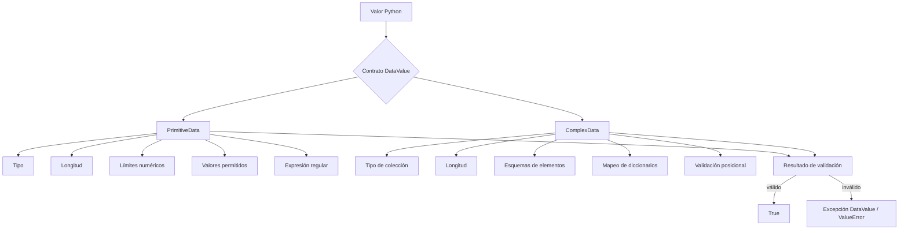

# Presentacion

**DataValue** es una libreria de Python ligera pero potente para la especificacion de datos estrictos usando valores simples y complejos.
Utilizable en tiempo de ejecucion y/o en estado estatico, permite definir restricciones sobre valores primitivos y compuestos, componer validadores recursivamente, validar contratos posicionales ordenados y serializar esquemas soportados para almacenamiento o transporte, entre otras operaciones.

> Conceptual y (mayormente) funcionalmente aplicable a cualquier tecnologia de programacion


# ¿Por qué existe DataValue?

Python es dinámicamente tipado. Las anotaciones de tipo mejoran la legibilidad y el análisis estático, pero no aplican por sí mismas restricciones en tiempo de ejecución como:

- valor numérico mínimo o máximo;
- longitud mínima o máxima;
- valores literales permitidos;
- coincidencia mediante expresiones regulares;
- validación de colecciones anidadas;
- restricciones sobre claves y valores de diccionarios;
- contratos posicionales ordenados.

DataValue proporciona una capa pequeña para esos casos.

Por ejemplo:

```python
from datavalue import PrimitiveData

port = PrimitiveData(
    data_type=int,
    value=443,
    minimum_size=1,
    maximum_size=65535,
)

assert port.validate()
```

El objeto representa al mismo tiempo una descripción del valor esperado y, salvo que se configure como plantilla/esquema, un contenedor cuyo valor se valida.

# Modelo conceptual



Una instancia configurada de `PrimitiveData` o `ComplexData` también puede formar parte de otro `ComplexData`, lo que permite composición recursiva.

# Instalacion

Para instalar la libreria unicamente ejecuta en un terminal:

```bash
$ pip install datavalue
```

O:

```bash
$ pip3 install datavalue
```

## Objetivos

El objetivo de esta libreria es implementar una forma basica y especifica para la descripcion de datos, y su validacion estricta. Ya que en mas de una ocasion, se validan criterios como:

- Tipo de dato:
  - Simple (primitivo): ```int```, ```str```, ```bool```, ```float```, ```None```, ```bytes```
  - Compuesto (complejo): ```list```, ```dict```, ```tuple```, ```range```
- Tamaño:
  - Minimo: ```int``` / ```float```
  - Maximo: ```int``` / ```float```
- Posibles valores: ```None``` / ```list``` / ```tuple```
- Patron: ```regex```

Entre otros.

Porque en mas de una ocasion se valida NO solo su **tipo de dato**, sino tambien sus caracteristicas.
E implementando interfaces de serializacion, y deserializacion para la presentacion, y transporte.

## Uso

Para utilizar la libreria, se deben importar las clases definidas:
```python
from datavalue import PrimitiveData, ComplexData, ValidationMode
```
> Lease mas en la documentacion de cada clase.

## Utilidades

Permite especificar el dato deseado, describiendo las caracteristicas que el valor proporcionado debe cumplir, para:
- Funciones/metodos
- Objetos
- Parametros/Retorno
- Entrada de datos
- Transporte de datos: serializacion/deserializacion

Para la validacion de datos de ingreso, y normalizacion de datos de egreso.

Su idea central es deliberadamente simple:

```text
valor
  +
tipo Python esperado
  +
restricciones opcionales
  =
contrato de validación DataValue
```

La librería proporciona dos abstracciones principales:

- **`PrimitiveData`** — validación de valores simples o primitivos.
- **`ComplexData`** — validación de valores compuestos y estructuras anidadas.

## Dependencias

La libreria no cuenta con ninguna dependencia. Es 100% instalable y utilizable de forma directa.

# Lo que DataValue **sí puede hacer**

## 1. Validar valores primitivos en tiempo de ejecución

```python
from datavalue import PrimitiveData

username = PrimitiveData(
    data_type=str,
    value="specter327",
    minimum_length=3,
    maximum_length=32,
    regular_expression=r"^[A-Za-z0-9_-]+$",
)

assert username.validate()
```

---

## 2. Validar rangos numéricos

```python
port = PrimitiveData(
    data_type=int,
    value=8443,
    minimum_size=1,
    maximum_size=65535,
)
```

---

## 3. Restringir valores a un conjunto permitido

```python
protocol = PrimitiveData(
    data_type=str,
    value="TCP",
    possible_values=("TCP", "UDP"),
)
```

`possible_values` puede contener:

- valores literales;
- tipos de Python;
- objetos `PrimitiveData` configurados;
- objetos `ComplexData` configurados cuando se utilizan dentro de esquemas compuestos.

---

## 4. Validar colecciones heterogéneas

Con el modo `ANY`, cada elemento puede coincidir con uno de varios validadores:

```python
schema = ComplexData(
    data_type=list,
    value=None,
    possible_values=(str, int),
    data_class=True,
)

assert schema.validate(["node-a", 10, "node-b", 20])
```

---

## 5. Validar contratos ordenados similares a firmas de funciones

El modo posicional puede describir parámetros o resultados ordenados:

```python
from datavalue import ComplexData, PrimitiveData, ValidationMode

name = PrimitiveData(
    data_type=str,
    value=None,
    minimum_length=1,
    data_class=True,
)

count = PrimitiveData(
    data_type=int,
    value=None,
    minimum_size=1,
    data_class=True,
)

enabled = PrimitiveData(
    data_type=bool,
    value=None,
    data_class=True,
)

contract = ComplexData(
    data_type=list,
    value=None,
    possible_values=(name, count, enabled),
    data_class=True,
    validation_mode=ValidationMode.POSITIONAL,
)

assert contract.validate(["example", 3, True])
```

Esto no satisface el mismo contrato:

```python
contract.validate([3, "example", True])
```

porque los dos primeros valores están intercambiados.

---

## 6. Componer esquemas anidados

Los esquemas pueden contener otros esquemas DataValue.

```python
port = PrimitiveData(
    data_type=int,
    value=None,
    minimum_size=1,
    maximum_size=65535,
    data_class=True,
)

address = PrimitiveData(
    data_type=str,
    value=None,
    minimum_length=1,
    data_class=True,
)

endpoint = ComplexData(
    data_type=dict,
    value=None,
    possible_values={
        "ADDRESS": address,
        "PORT": port,
    },
    data_class=True,
)

assert endpoint.validate({
    "ADDRESS": "192.168.1.10",
    "PORT": 443,
})
```

Esta composición recursiva es una de las capacidades más útiles de DataValue: validadores pequeños pueden combinarse en contratos mayores.

---

## 7. Restringir claves y valores de diccionarios

DataValue soporta dos estilos principales.

### Validadores genéricos de claves y valores

```python
profile = ComplexData(
    data_type=dict,
    value=None,
    possible_values=(
        [str],
        [str, int, bool],
    ),
    data_class=True,
)

assert profile.validate({
    "name": "Specter",
    "level": 10,
    "active": True,
})
```

### Esquemas de mapeo

```python
profile = ComplexData(
    data_type=dict,
    value=None,
    possible_values={
        "name": str,
        "age": int,
        "active": bool,
    },
    data_class=True,
)
```

El modo de mapeo rechaza claves suministradas que no coincidan con alguna regla configurada.

---

## 8. Serializar esquemas DataValue soportados

Ambas clases principales exponen:

```python
to_dict()
to_json()
from_dict(...)
from_json(...)
```

Ejemplo:

```python
encoded = contract.to_json()
restored = ComplexData.from_json(encoded)

assert restored.validate(["example", 3, True])
```

La deserialización utiliza un mapeo controlado de tipos permitidos en lugar de importar clases arbitrarias.

`PrimitiveData` serializa valores `bytes` y `bytearray` mediante Base64.

Ejemplo de serializacion:
```python
text = datavalue.PrimitiveData(
	data_type=str, 
	value=None, 
	data_class=True, 
	maximum_length=10, 
	minimum_length=1
)

print(text.to_json())
{
    "DATA_TYPE": "str",
    "VALUE": null,
    "NAME": null,
    "DESCRIPTION": null,
    "MAXIMUM_LENGTH": 10,
    "MINIMUM_LENGTH": 1,
    "MAXIMUM_SIZE": null,
    "MINIMUM_SIZE": null,
    "POSSIBLE_VALUES": null,
    "REGULAR_EXPRESSION": null,
    "DATA_CLASS": true,
    "__type__": "PrimitiveData"
}

list = datavalue.ComplexData(
	data_type=list, 
	value=None, 
	data_class=True, 
	minimum_length=1
)

print(list.to_json())
{
    "DATA_TYPE": "list",
    "NAME": null,
    "DESCRIPTION": null,
    "VALUE": null,
    "MAXIMUM_LENGTH": null,
    "MINIMUM_LENGTH": 1,
    "POSSIBLE_VALUES": null,
    "DATA_CLASS": true,
    "VALIDATION_MODE": "any",
    "__type__": "ComplexData"
}
```

Dichos datos serializados pueden ser cargados en una clase de Python rehidratada, almacenados, y transportados.

---

# Modo valor y modo esquema

Tanto `PrimitiveData` como `ComplexData` aceptan el parámetro `data_class`.

## Modo valor

Por defecto:

```python
data_class=False
```

El valor suministrado se valida durante la construcción.

```python
port = PrimitiveData(
    data_type=int,
    value=443,
    minimum_size=1,
    maximum_size=65535,
)
```

## Modo esquema o plantilla

```python
data_class=True
```

La construcción no valida inmediatamente el valor almacenado. El objeto puede reutilizarse:

```python
port_schema = PrimitiveData(
    data_type=int,
    value=None,
    minimum_size=1,
    maximum_size=65535,
    data_class=True,
)

port_schema.validate(22)
port_schema.validate(443)
port_schema.validate(65535)
```

Conceptualmente:

```text
data_class = False
    contrato + valor
         ↓
 validación inmediata

data_class = True
    contrato reutilizable
         ↓
 validate(valor)
         ↓
 validate(otro_valor)
```

# Casos de uso previstos

DataValue es razonable para sistemas que necesiten:

- validación de parámetros en runtime;
- contratos ligeros de aplicación;
- validación de payloads;
- configuración;
- esquemas reutilizables;
- contratos ordenados de argumentos o resultados;
- estructuras anidadas simples;
- persistencia de esquemas en los casos soportados.

Ejemplos:

```text
parámetros de funciones
configuración
descripciones de endpoints
mensajes de aplicación
entrada CLI
resultados estructurados
contratos internos pequeños
```


## Demostraciones

(Indice de demostraciones)[docs/demostrations/index.md]